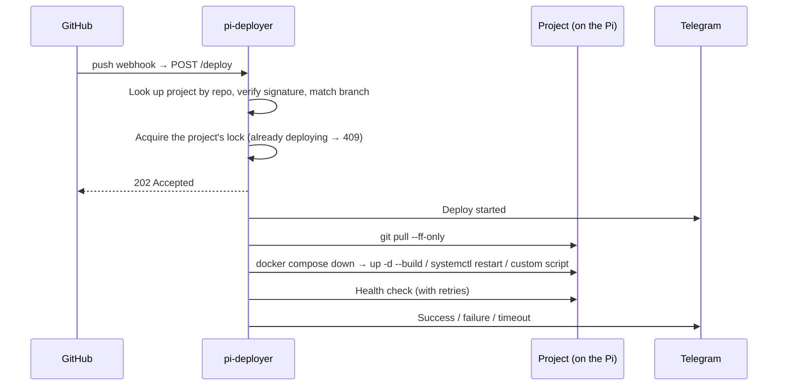

# pi-deployer

[繁體中文](README.md) | English

> One webhook URL to auto-deploy every self-hosted project on a Raspberry Pi.

> [!NOTE]
> This is a lightweight tool built for my own Pi. It only handles GitHub webhooks, a single machine and Telegram notifications, with no UI, multi-user support or job queue. If your setup is different, expect to adapt it.

## Why

I run several self-hosted services on a Raspberry Pi at home. Every change meant pushing to GitHub, SSH-ing in, running `git pull` and restarting the service. My little brain can't keep track of all that.

So I built pi-deployer: after a push, GitHub notifies the Pi, which pulls, redeploys and health-checks the project, then reports the result to Telegram. Putting a new project on auto-deploy takes a few lines in `projects.yml`, and frees up a bit more of my brain 😎

## Features

- **One URL for all projects**: routes each webhook by the `owner/repo` in its payload
- **4 deploy modes**: `docker-compose`, `systemd`, `pull-only` and `script-only`, plus custom deploy scripts
- **Post-deploy health checks**: configurable retries, interval and `initial_delay`, so a slow container start isn't reported as a failure
- **Telegram notifications**: on start, success, failure (with the tail of the log) and timeout
- **Hot config reload**: `POST /reload` or `systemctl reload` after editing `projects.yml`, without interrupting running deploys
- **Security**: HMAC-SHA256 signature verification for webhooks, Bearer token for manual triggers and admin endpoints
- **No overlapping deploys**: one deploy per project at a time; duplicate requests get a 409

## How it works



Deploys run in a background thread, so the webhook gets an immediate response and GitHub never times out waiting for a long deploy.

## Tech choices

- **Python + Flask** with just 4 external dependencies (flask, pyyaml, requests, python-dotenv)
- **No Celery or Redis**: the Pi has limited resources and webhooks arrive a few to a few dozen times a day. `threading.Lock` plus `threading.Thread` is enough, with no extra processes
- **Managed by systemd**: `ExecReload` sends SIGHUP, which reloads the config

## Design highlights

- **Race-free locking**: uses the atomic `lock.acquire(blocking=False)` instead of checking `locked()` and then calling `acquire()`, so two requests can't both pass the check (TOCTOU)
- **Secret precedence**: a project's own `webhook_secret` wins over the global secret; if neither is set, the request gets a 401 and nothing deploys without a secret
- **Daemon thread trade-off**: `systemctl stop` never hangs on a running deploy. The cost is that a deploy may be cut off, but rerunning it is enough
- **Defensive details**: `hmac.compare_digest` against timing attacks, project key validation, symlink protection for log paths, and sanitized commit info before it reaches subprocesses

Full write-up (in Chinese): [docs/design.md](docs/design.md).

## Quick start

```bash
git clone <repo-url> ~/pi-deployer && cd ~/pi-deployer
python3 -m venv venv && source venv/bin/activate
pip install -r requirements.txt

cp .env.example .env                    # set GITHUB_WEBHOOK_SECRET and DEPLOY_TOKEN
cp projects.example.yml projects.yml    # add your projects
python3 deployer.py
```

```yaml
# projects.yml
projects:
    - name: my-blog
      repo: your-github-user/my-blog
      path: /home/pi/my-blog
      deploy_mode: docker-compose
      health_check:
          enabled: true
          url: http://localhost:4000
```

Then add a webhook pointing to `https://your-domain/deploy` under each GitHub repo's Settings → Webhooks. Every repo needs its own webhook.

For adding projects, config fields, the API, and systemd and sudoers setup, see [docs/guide.md](docs/guide.md) (in Chinese).

## Project structure

```
pi-deployer/
├── deployer.py          # Flask app + routes + entry point
├── config.py            # Config loading / merging / hot reload
├── deploy.py            # Deploy engine (4 modes)
├── verify.py            # HMAC-SHA256 + Bearer token verification
├── notify.py            # Telegram notifications
├── health.py            # HTTP health checks (with retries)
├── projects.example.yml # Project config template (copy to projects.yml)
├── .env.example         # Environment variable template
├── docs/
│   ├── guide.md         # Usage guide
│   └── design.md        # Design notes
├── scripts/
│   └── deploy-template.sh   # Custom deploy script template
└── systemd/
    └── pi-deployer.service  # systemd unit file
```
