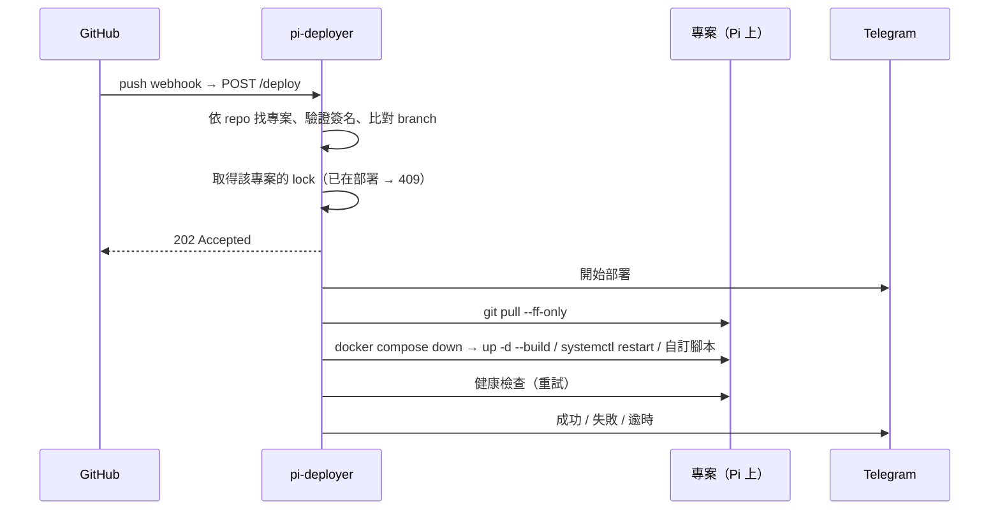

# pi-deployer

繁體中文 | [English](README.en.md)

> 一個 webhook URL，管好 Raspberry Pi 上所有自架專案的自動部署。

> [!NOTE]
> 這是為了我自己的 Pi 客製、以輕量為優先的工具：只處理 GitHub webhook、單台機器、Telegram 通知，沒有 UI、多使用者或任務佇列。如果你的環境不同，可能需要自己調整。

## 緣起

家裡的 Raspberry Pi 上跑著好幾個自架服務。每次改完設定推上 GitHub、SSH 進去 `git pull`、重啟服務。但我的小腦袋裝不下這麼多東西。

所以做了 pi-deployer：push 之後 GitHub 會通知 Pi，自動拉取、部署、做健康檢查，結果直接推到 Telegram。之後要讓新專案自動部署，只要在 `projects.yml` 加幾行，大腦空間又省下一點 😎

## 功能

- **一個 URL 對應所有專案**：依 webhook payload 裡的 `owner/repo` 找到對應的專案
- **4 種部署模式**：`docker-compose`、`systemd`、`pull-only`、`script-only`，也可以掛自訂部署腳本
- **部署後健康檢查**：可設定重試次數、間隔與 `initial_delay`，避免容器冷啟動慢被誤判為失敗
- **Telegram 通知**：開始、成功、失敗（附 log 結尾）、逾時都會通知
- **設定熱重載**：改完 `projects.yml` 後 `POST /reload` 或 `systemctl reload`，不中斷進行中的部署
- **安全**：webhook 用 HMAC-SHA256 驗證簽名，手動觸發與管理 endpoint 需要 Bearer token
- **防止重複部署**：同一專案同時只會有一個部署在跑，重複的請求直接回 409

## 運作流程



部署在背景 thread 執行，webhook 會立即得到回應，不會因為部署太久而被 GitHub 判定逾時。

## 技術選擇

- **Python + Flask**，只有 4 個外部依賴（flask、pyyaml、requests、python-dotenv）
- **不用 Celery 或 Redis**：Pi 的資源有限，webhook 一天也只有幾次到幾十次。用 `threading.Lock` 加 `threading.Thread` 就夠了，不需要額外的 process
- **systemd 管理**：`ExecReload` 會送 SIGHUP，觸發設定重載

## 幾個設計重點

- **沒有競態的 lock**：用 `lock.acquire(blocking=False)` 這個原子操作，取代「先 `locked()` 檢查再 `acquire()`」，避免兩個請求同時通過檢查（TOCTOU）
- **Secret 的優先順序**：專案自己的 `webhook_secret` 優先，其次是全域 secret；兩者都沒設定就直接回 401，不會在沒有 secret 的情況下部署
- **daemon thread 的取捨**：`systemctl stop` 不會因為部署進行中而卡住。代價是部署可能被中斷，但重跑一次就好
- **防禦細節**：用 `hmac.compare_digest` 避免時序攻擊、project key 的格式驗證、log 路徑的 symlink 防護、傳給 subprocess 的 commit 資訊會先清理

完整說明見 [docs/design.md](docs/design.md)。

## 快速開始

```bash
git clone <repo-url> ~/pi-deployer && cd ~/pi-deployer
python3 -m venv venv && source venv/bin/activate
pip install -r requirements.txt

cp .env.example .env                    # 填入 GITHUB_WEBHOOK_SECRET、DEPLOY_TOKEN
cp projects.example.yml projects.yml    # 加入你的專案
python3 deployer.py
```

```yaml
# projects.yml
projects:
    - name: my-blog
      repo: your-github-user/my-blog
      path: /home/pi/my-blog
      deploy_mode: docker-compose
      health_check:
          enabled: true
          url: http://localhost:4000
```

接著在 GitHub repo 的 Settings → Webhooks 加一條指向 `https://your-domain/deploy` 的 webhook，每個 repo 都要各自設定一次。

新增專案的步驟、設定欄位、API、systemd 與 sudoers 設定，請見 [docs/guide.md](docs/guide.md)。

## 專案結構

```
pi-deployer/
├── deployer.py          # Flask app + routes + 入口點
├── config.py            # 設定檔載入 / 合併 / 熱重載
├── deploy.py            # 部署執行引擎（4 種模式）
├── verify.py            # HMAC-SHA256 + Bearer token 驗證
├── notify.py            # Telegram 通知
├── health.py            # HTTP 健康檢查（帶重試）
├── projects.example.yml # 專案設定檔範本（複製為 projects.yml 使用）
├── .env.example         # 環境變數範本
├── docs/
│   ├── guide.md         # 使用指南
│   └── design.md        # 設計考量
├── scripts/
│   └── deploy-template.sh   # 自訂部署腳本模板
└── systemd/
    └── pi-deployer.service  # systemd unit file
```

